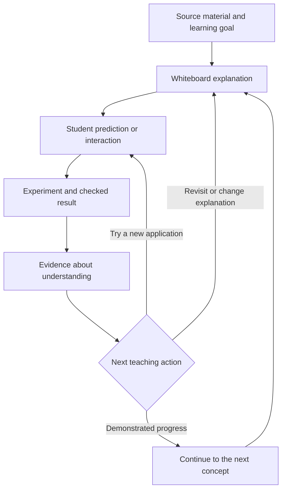

# ClaimLab — Detailed Idea Explanation

**An adaptive visual learning and experimentation workspace for understanding research papers and technical material.**

**Idea owner:** Ravi  
**Document date:** 27 October 2026  
**Status:** Product concept; the behaviors described here are intended capabilities, not claims that the application has already been built or validated.  
**Purpose:** Explain the idea in detail from the founder, student, developer, hackathon judge, and coding-assistant perspectives. This is a concept document, not a development schedule, implementation specification, or set of execution instructions.

---

## Contents

1. [The idea in plain language](#1-the-idea-in-plain-language)
2. [The founder's perspective: the original vision](#2-the-founders-perspective-the-original-vision)
3. [The student's perspective: what using ClaimLab feels like](#3-the-students-perspective-what-using-claimlab-feels-like)
4. [The three connected parts of the product](#4-the-three-connected-parts-of-the-product)
5. [An illustrative learning session](#5-an-illustrative-learning-session)
6. [The observation mechanism and harness](#6-the-observation-mechanism-and-harness)
7. [The developer's perspective: the system behind the experience](#7-the-developers-perspective-the-system-behind-the-experience)
8. [The judge's perspective: what makes this a meaningful entry](#8-the-judges-perspective-what-makes-this-a-meaningful-entry)
9. [The Claude Code perspective](#9-the-claude-code-perspective)
10. [The Codex perspective](#10-the-codex-perspective)
11. [The Antigravity perspective](#11-the-antigravity-perspective)
12. [The focused first version and the broader vision](#12-the-focused-first-version-and-the-broader-vision)
13. [What success means](#13-what-success-means)
14. [Canonical explanation of ClaimLab](#14-canonical-explanation-of-claimlab)
15. [Sources and interpretation](#15-sources-and-interpretation)

## 1. The idea in plain language

ClaimLab helps a student understand difficult material by combining a visual teacher, a shared whiteboard, executable experiments, and an observation mechanism that guides the next teaching step.

A student brings material recommended by a teacher: a research paper, a technical chapter, or notes. The student chooses what they want to understand. ClaimLab identifies the relevant concepts and prerequisites, explains one part at a time, and draws the explanation while teaching.

When a concept can be explored computationally, ClaimLab creates a small experiment. The student can predict the result, run it, change an input, and inspect the outcome. The explanation and the experiment stay connected to the original material.

The student participates throughout the lesson. Their answers, drawings, parameter changes, requests for help, and explanations provide evidence about their current understanding. ClaimLab uses this evidence to choose whether to continue, simplify, revisit a prerequisite, change its representation, or offer another experiment.

The central product promise is:

> **Understand an idea by seeing it, testing it, explaining it, and applying it—with a tutor that changes its approach when your work shows you need something different.**

The name ClaimLab expresses two responsibilities. A claim or method should remain connected to its source, and a lab should let the learner investigate it through observable actions and results.

## 2. The founder's perspective: the original vision

### 2.1 The problem Ravi wants to solve

Teachers recommend books and papers because they contain important knowledge. However, reading the material and building a usable understanding can take considerable effort. A student may struggle with unfamiliar notation, missing prerequisites, dense explanations, or the gap between a formula and its behavior.

The original idea is to give that student a teaching companion. It should draw and explain like a teacher at a whiteboard, allow questions and participation, and become more helpful as it observes the student's work.

Combining that vision with ClaimLab adds a practical investigation layer. The student can see a concept operate, change its conditions, and compare a prediction with an actual result.

### 2.2 The intended relationship with reading

ClaimLab supports engagement with the material. It helps the student enter a difficult passage, understand its dependencies, and return to it with a better mental model.

It should make source passages easier to approach and discuss. A student should be able to move from an explanation back to the exact equation, paragraph, or figure that motivated it.

The product should be described as a learning aid. Claims that it eliminates the need to read, guarantees mastery, or teaches every subject reliably would exceed the idea's demonstrated scope.

### 2.3 What combining the two ideas means

The whiteboard and the lab share the same learning goal and session history. A mistake in an experiment can trigger a visual explanation. A question on the whiteboard can become an experiment. A successful new application can let the teacher move to a more demanding concept.

For example, the agent might notice that the student can repeat a formula but cannot predict how its output changes. It could select a controlled experiment and ask for a prediction before revealing the result.

The observation mechanism connects these activities. It helps the system choose a teaching action based on evidence rather than merely following a fixed presentation.

## 3. The student's perspective: what using ClaimLab feels like

### 3.1 Bringing material and choosing a goal

The student uploads supported material and states a goal such as:

- Understand the main mechanism in this section.
- Explain this equation in plain language.
- Explore why this design choice matters.
- Implement a small example and understand its output.
- Check whether I can explain this concept independently.

ClaimLab makes clear which pages or sections it could read and which parts it can support. A scanned equation that could not be interpreted reliably should remain an acknowledged gap.

The student chooses a focused learning question. A long document may contain multiple possible lessons; uploading it should not imply that every page has been processed into a reliable course.

### 3.2 Establishing a starting point

ClaimLab asks a small number of relevant questions or offers a short task. The purpose is to find an appropriate starting point without making the student complete a long assessment.

A student can also state preferences directly: explanation language, desired pace, mathematical detail, and whether they want intuition before notation.

These preferences describe the student's choices. They remain separate from evidence about what the student understands. Requesting a diagram does not establish mastery, and answering slowly does not establish confusion.

### 3.3 Learning through a shared whiteboard

The agent draws one meaningful step at a time. It might introduce objects, label relationships, reveal part of an equation, highlight a connection, or compare two states.

The student can pause, ask about an element, request a different explanation, or interact with the board. Supported interactions could include connecting nodes, moving objects, annotating a step, or selecting the part they find confusing.

The lesson should preserve context. If the agent revises one part of a diagram, the student should still recognize how that part relates to the larger explanation.

An animation should express a relationship or change: a value flowing through a calculation, a connection being selected, or an outcome changing after an intervention.

### 3.4 Learning through an experiment

The student sees the question the experiment investigates, its assumptions, and the inputs they can change. Before running it, ClaimLab may ask what the student expects to happen and why.

The resulting chart or diagram comes from the executed calculation. The student can inspect relevant values and compare conditions. The agent explains the observed outcome within the experiment's stated scope.

A small experiment may illustrate a mechanism without reproducing an entire paper. That distinction remains visible.

### 3.5 Receiving help that responds to their work

The student should experience a clear connection between their difficulty and the agent's next action.

For example: “Your drawing connects the attention weights directly to the keys. Let's inspect what information the values contribute.” This refers to an observable action and offers a useful next step.

The agent can ask a diagnostic follow-up when the evidence is ambiguous. It should not treat one wrong response as proof of a stable weakness.

### 3.6 Returning to a later session

If the student chooses to retain learning history, ClaimLab can remember the concepts discussed, tasks attempted, help needed, and preferences explicitly selected.

On return, it can offer a brief retrieval or application task before assuming that understanding has persisted. Previously demonstrated understanding is useful context, with uncertainty about retention.

The student can inspect, correct, or reset this learning record. Uploaded material and individual learning history remain separate from any public project demonstration.

## 4. The three connected parts of the product

### 4.1 The adaptive visual teacher

The visual teacher selects a useful explanation, breaks it into manageable steps, and presents it through coordinated text, drawing, and interaction. Spoken explanation is a possible extension; the central experience should remain understandable through visible content.

It can move between intuition, a concrete example, a diagram, an equation, and a worked application. Its choice depends on the learning goal and the student's current evidence.

Its responsibility is to maintain a coherent lesson. Attractive visuals alone do not establish that the explanation is correct or appropriate.

### 4.2 The experiment agent

The experiment agent turns an investigable question into a bounded computational exercise. It identifies what is varied, what is measured, what is held constant, and what assumptions are introduced.

It produces or selects a supported implementation, executes it within limits, checks the outputs, and returns results that the interface can visualize.

The experiment can reveal an error in the learner's expectation or in the agent's own initial explanation. Either outcome should lead to an honest revision.

Successful execution establishes that code ran. Additional checks are needed to establish that it implemented the intended method and that the interpretation is justified.

### 4.3 The observation and adaptation mechanism

This mechanism connects student actions to teaching choices. It maintains an evidence-based picture of understanding at the concept level and selects a useful next action.

It can recommend revisiting a prerequisite, reducing the number of simultaneous steps, offering a counterexample, changing the representation, or testing a more demanding application.

The adaptation should be inspectable through a concise decision record: what was observed, the tentative interpretation, the selected teaching action, and what happened afterward.

### 4.4 The relationship between the three parts

This diagram describes a possible learning loop. Lessons can enter the loop through a question, a drawing, or an experiment rather than following one mandatory sequence.

## 5. An illustrative learning session

**The following is a hypothetical product scenario, not a report of measured student outcomes.**

### 5.1 The student's question

A student uploads a supported section of *Attention Is All You Need* and asks why scaled dot-product attention includes a scaling factor. The paper's Section 3.2.1 is the source anchor for this example.[2]

### 5.2 The first explanation

ClaimLab draws queries, keys, and values, then shows the calculation as connected operations. The student can select an operation to ask what it contributes.

Before proceeding, the agent asks the student to distinguish the scores used for weighting from the values being combined. This checks whether the current question depends on an earlier conceptual gap.

### 5.3 The controlled investigation

ClaimLab proposes an illustrative experiment using synthetic vectors. For the same sampled queries and keys within each comparison, it computes scores with and without division by the square root of the key dimension.

Under independent, zero-mean, unit-variance component assumptions, an unscaled query-key dot product has variance equal to the key dimension. The paper uses this reasoning to motivate scaling and discusses the effect of large scores on softmax gradients.[2]

The interface can show score distributions and resulting attention weights across several dimensions. Multiple random seeds help distinguish a general pattern under these assumptions from one particular sample.

The student sees that these are synthetic examples with stated assumptions. They are not learned embeddings from a trained Transformer and do not reproduce the paper's translation benchmarks.

### 5.4 The student's intervention

The student predicts what changing the dimension will do, then changes it and runs the comparison. ClaimLab asks the student to explain the relationship between the results and the scaling step.

Suppose the student's explanation suggests that they expect identical attention weights for every input. ClaimLab records this as a possible misconception and asks a follow-up before choosing a corrective lesson.

### 5.5 The adapted explanation

The teacher uses a smaller numerical example to separate the effect of changing score scale from the information carried by the scores. It redraws the relevant operation and connects the smaller example to the experiment already on screen.

The student can inspect the intermediate values instead of accepting the explanation solely because the agent sounds confident.

### 5.6 The new application

ClaimLab offers a different example that requires applying the relationship. It records the student's reasoning and the assistance needed.

A successful attempt provides evidence of progress on that concept. Repeated independent applications and a later revisit would provide stronger evidence than a single immediately repeated question.

### 5.7 The retained session record

The session can retain the source anchor, experiment assumptions, actual run outputs, student prediction, tentative misconception, teaching adjustment, and follow-up result.

This makes the learning path inspectable. It also gives a later session a useful starting point without treating the earlier result as a permanent assessment.

## 6. The observation mechanism and harness

### 6.1 What “observation” means

Observation means using actions that occur within the learning experience. It does not require a camera, facial analysis, or guesses about the student's private mental state.

Relevant evidence includes submitted answers, explanations, diagram edits, parameter choices, requests for hints, and performance on new applications. Timing can provide context, but timing alone should not determine whether someone understands.

| Observable evidence | Tentative interpretation | Possible teaching response |
| --- | --- | --- |
| Repeatedly reversing a relationship in different tasks | A directional relationship may be misunderstood | Draw a contrasting example and ask the student to correct it |
| Correct explanation but incorrect arithmetic | The conceptual model may be sound while calculation needs support | Show intermediate calculations without restarting the whole topic |
| Repeating a formula without predicting its behavior | Understanding may be limited to recall | Ask for a prediction and run a controlled comparison |
| Several successful unfamiliar applications with little help | There is stronger evidence of transferable understanding | Offer a more demanding task or proceed |
| Requesting another explanation | The current explanation may not be useful | Offer another representation and check its effect |
| Long inactivity without a response | The reason is unknown | Allow the student to resume or request help |

The interpretations in this table are hypotheses to investigate, not automatic diagnoses.

### 6.2 The learning record

The record describes understanding by concept. It can include what has been introduced, what the student has attempted, recurring error patterns, prerequisite uncertainty, and whether success required substantial hints.

It can also retain the teaching approaches tried and the evidence observed afterward. A representation that helped in one situation can be useful to try again, with no assumption that it is always the student's best representation.

A simple evidence description can be more honest than a highly precise mastery percentage. If numerical estimates are eventually used, their meaning and uncertainty would need validation.

### 6.3 The adaptation decision

A meaningful adaptation has four linked parts:

1. **Observation:** What did the student actually do?
2. **Interpretation:** What possible gap does that action suggest?
3. **Response:** Why is this explanation, prerequisite, or experiment a useful next step?
4. **Follow-up:** What evidence indicates whether the response helped?

This record should contain concise, observable explanations. It does not require exposing a model's private internal reasoning.

### 6.4 Three related meanings of “harness”

| Mechanism | What it evaluates | Why it exists |
| --- | --- | --- |
| **Learning observation loop** | Student attempts and the effect of teaching actions | Select a useful next learning step |
| **Experiment verification harness** | Whether an experiment implements the intended calculation and satisfies relevant checks | Keep results and interpretations dependable |
| **Product evaluation harness** | Whether complete sessions behave correctly across representative cases | Detect regressions, misleading explanations, and broken interactions |

These mechanisms share records, but they answer different questions. An experiment can pass its numerical checks while its explanation fails to help a student. A student can enjoy a lesson whose experiment contains an error. Both outcomes matter.

### 6.5 Personalization over time

The initial concept uses session history and teaching policy to adapt. It does not depend on training a separate model for each student.

Longer-term improvement could involve evaluating which approaches are associated with better independent performance. Such evidence would need careful interpretation: association does not automatically establish that a teaching choice caused the improvement.

The product should avoid assigning permanent learning-style labels from a small set of actions. Its useful question is: “What should help with this concept now, given the evidence available?”

## 7. The developer's perspective: the system behind the experience

### 7.1 The central engineering idea

ClaimLab is a stateful learning workflow. The source interpretation, current board, experiment, student evidence, and teaching decision need to remain consistent as the session changes.

The visible conversation is one part of that workflow. Durable product state should not depend exclusively on reconstructing meaning from a growing transcript.

### 7.2 The conceptual components

| Component | Responsibility |
| --- | --- |
| Material understanding | Identify supported text, equations, figures, and source locations; preserve uncertainty |
| Concept and prerequisite map | Connect the learning goal to the ideas needed to approach it |
| Teaching coordinator | Choose the next explanation, interaction, experiment, or assessment |
| Shared whiteboard | Maintain meaningful objects, relationships, annotations, and teaching steps |
| Experiment workspace | Describe a question, execute bounded calculations, and retain actual outputs |
| Observation mechanism | Turn student actions into qualified evidence about understanding |
| Verification and evaluation | Check source support, experiment behavior, and complete learning flows |
| Session memory | Preserve progress, preferences, revisions, and run history with user control |

These are logical responsibilities. They do not require a separate service or separate model for every row.

### 7.3 The important objects the application understands

The product needs a shared vocabulary. A **source anchor** identifies the passage or equation behind a lesson. A **concept** describes an idea and its prerequisites. A **board object** has meaning and identity, such as a matrix, operation, or connection.

An **experiment description** records the question, assumptions, inputs, measurements, and limits. An **experiment run** records what actually executed and the resulting outputs. A **learner event** records an action. A **teaching decision** connects that evidence to a response.

Keeping these meanings distinct helps prevent a generated explanation from being mistaken for an executed result or a source statement from being mistaken for a measured observation.

### 7.4 How the agent draws

The agent selects meaningful drawing actions: add an object, connect two objects, reveal an equation step, highlight a region, or update a value. The application interprets these actions through a controlled drawing system.

Objects retain identity so that a student can refer to “this arrow” or revisit a previous step. When supported, a student's drawing or handwriting can be interpreted with uncertainty and clarified before it drives a major teaching change.

Precise plots and equations should be produced from their underlying data and structure. Generative imagery may help with an illustration, but measured charts need to correspond to the experiment's numerical outputs.

### 7.5 How experiments remain dependable

An experiment has a bounded purpose. It runs in an isolated environment with resource limits and a defined set of permitted operations. Uploaded source text is material to interpret, not authority to execute arbitrary instructions.

Verification should combine relevant deterministic checks and source review. For example, a probability-producing calculation may need checks on normalization and numerical finiteness. A method implementation may need a comparison with a small trusted reference calculation.

The same model expressing confidence in its own output is insufficient evidence of correctness. Check results should remain inspectable, including failures.

If the agent repairs a failed implementation, it should preserve the intended method and disclose material changes. Simplifying an experiment is acceptable when labelled; quietly changing the question to obtain a successful result is misleading.

### 7.6 Synchronization between the lesson and the lab

When an input changes, a previously displayed result may become stale. ClaimLab should keep the relationship between inputs, run outputs, board state, and explanation explicit.

An explanation of one run must not silently appear beside results from another. Corrections to an equation or source interpretation may require revisiting a dependent experiment and the conclusions drawn from it.

Student interruptions also change the session state. The agent should be able to pause its current explanation, address the interruption, and resume with the relevant context intact.

### 7.7 Source grounding and knowledge boundaries

The interface should distinguish five kinds of content:

1. A statement supported by the uploaded material.
2. Background explanation added to teach a prerequisite.
3. An assumption introduced for an illustrative experiment.
4. An observation produced by an actual run.
5. An interpretation or uncertainty that requires qualification.

This separation supports both learning and technical credibility. A citation establishes where a statement came from; it does not by itself establish that the agent interpreted it correctly.

### 7.8 The role of Meta models

The proposed Meta model role is substantive: interpret material and student work, select teaching actions, and use tools to update the board or investigate an experiment. Meta documents multimodal inputs, tool calling, and structured output as relevant building blocks.[3]

The model helps coordinate actions. The application executes calculations, renders precise visuals, and evaluates their outputs. The exact model and supported modalities would be selected after capability and access validation.

The idea does not depend on using every available Meta model. Each model used should have a clear product responsibility.

### 7.9 Technical details that belong behind the experience

Run records, model calls, and verification details should be available for inspection without overwhelming the student. The main experience remains focused on the learning question and the evidence needed to understand it.

For a developer or reviewer, those records explain how an output was produced. For the student, the essential message may simply be that a result is current, what assumptions it uses, and what it demonstrates.

## 8. The judge's perspective: what makes this a meaningful entry

### 8.1 The problem and intended beneficiaries

The initial audience is students and early researchers who need to understand technical methods in AI/ML papers. The product addresses the gap between reading a description and being able to reason about or apply it.

Its potential value comes from making difficult concepts investigable and providing targeted help when a student's work reveals a gap. The extent of that value must be demonstrated rather than assumed.

### 8.2 The proposed theme fit

The recommended theme is **Push the Frontier**. The participant guide includes software capabilities and the acceleration of scientific experiments within that theme.[1]

ClaimLab's proposed contribution is a workflow in which a model interprets a method, coordinates a bounded experiment, presents real results, and responds to the learner's interventions. That is the substantive basis for this interpretation of fit.

The guide also lists simple education chatbots and basic RAG applications among projects to avoid. ClaimLab therefore needs to demonstrate actual execution, verification, interaction, and adaptation. A new label or attractive interface would not establish eligibility. The organizers retain authority over rule interpretation.

### 8.3 How the four judging criteria apply

| Official criterion | Weight in the supplied guide | What a judge should be able to assess in ClaimLab |
| --- | --- | --- |
| Impact | 30% | A clear learning problem, a defined audience, and credible evidence that the workflow helps |
| Use of Meta AI Tooling | 25% | Meta models making meaningful decisions about material, teaching, interaction, and tool use |
| Technical Depth & Execution | 20% | Consistent state, grounded explanations, trustworthy calculations, and recoverable failures |
| Demo | 25% | A functioning learning journey in which student input changes what happens next |

These weights are taken from the provided participant guide. They explain the assessment context, not a predicted project score.[1]

### 8.4 The important demonstration moment

A strong moment is a visible, evidence-based teaching adjustment. The student makes a prediction or changes a diagram; the agent identifies a possible gap, selects a relevant intervention, and checks a new application.

The experiment's result should be available for inspection. A judge should be able to see which computation ran, which assumptions matter, and how the displayed explanation relates to that computation.

An unsuccessful run can also demonstrate engineering quality if the system recognizes it, avoids inventing an outcome, and explains what remains unresolved.

### 8.5 What would weaken the idea in review

The concept would be weakly represented by a prerecorded lecture with no consequential interaction, a generic chat interface with occasional pictures, or charts whose values were invented by the model.

It would also be weakened by unsupported mastery claims, hardcoded responses presented as adaptive reasoning, or claims to reproduce an entire study when the application only runs a toy example.

These are distinctions about demonstrated behavior. The project should be described according to what it actually does.

### 8.6 How to discuss originality honestly

ClaimLab combines source-linked teaching, a shared whiteboard, small executable experiments, and an inspectable learning loop. The intended distinction is the connection between those parts and the quality of the resulting experience.

The concept does not establish that each ingredient is new or that no competing product combines similar features. Any competitive novelty claim would require separate evidence.

### 8.7 The submission context

The supplied guide requires public repositories, work created during the event to be clearly identified, teams of up to four, and a three-minute demo video.[1]

Those conditions shape how the project can be reviewed. Public source code does not require publishing students' uploads or private learning records. The repository can include appropriate demonstration material and examples while preserving the rights associated with external content.

## 9. The Claude Code perspective

**This section describes a useful conceptual reading of the idea for Claude Code. It does not claim exclusive tool capabilities or assign ownership of the project to one assistant.**

### 9.1 The product understanding to preserve

Claude Code should understand ClaimLab as an adaptive teaching and experimentation workflow. The learning goal, source evidence, board state, experiment state, and student's demonstrated understanding all contribute to the next action.

The whiteboard has instructional meaning. A board action should express a concept, ask the student to participate, or respond to an observed difficulty. The teaching coordinator should be explainable through its observable inputs and choices.

### 9.2 The central behavior to reason about

An agent may have several plausible next actions. A student who confuses two objects might benefit from a contrasting example. A student who understands the concept but makes an arithmetic error may need a calculation step. A student who succeeds with assistance may need an independent application before progressing.

The idea therefore requires qualified interpretation rather than rigid “wrong answer means repeat lesson” behavior. Uncertainty can lead to a diagnostic question.

### 9.3 What would count as a misunderstanding of the brief

A session that generates the whole lesson once and then only answers follow-up questions would omit the intended feedback loop. Similarly, personalization based only on a profile preference would miss the central role of student evidence.

Another misunderstanding would be to create multiple named agents without giving each a necessary responsibility. Logical roles can be served by a simpler implementation; the product value comes from effective coordination.

### 9.4 The useful explanation this assistant should be able to give

For any teaching change, it should be possible to explain what evidence motivated it, which concept it addresses, why the chosen action is relevant, and what later observation would indicate progress.

That explanation is a product-level account of behavior. It should remain consistent with the experiment results and the source material.

## 10. The Codex perspective

**This section emphasizes verifiable behavior when Codex reads the concept. The same expectations apply to every development assistant.**

### 10.1 The product understanding to preserve

ClaimLab connects an interpretation of a source to executable actions and visible evidence. A formula in a lesson, the operation implemented by an experiment, and the values shown in a chart need to agree.

The application needs to distinguish a proposed experiment from a running one, a completed run from a failed run, and current results from results associated with earlier inputs.

### 10.2 The central behavior to reason about

The key question is whether the product's visible claims follow from its recorded actions. A successful model response does not establish that code ran. A successful process exit does not establish that the right method ran. A passing numerical check does not establish that the student learned the concept.

Each conclusion needs evidence suited to it. This is the foundation for dependable experiments and honest demonstrations.

### 10.3 What would count as a misunderstanding of the brief

Hardcoded result values displayed as a live run would misrepresent the experiment. Tests that only confirm the model returned text would leave the important behavior unverified.

Another misunderstanding would be to save every event without using the events to influence teaching. Recording a history is useful, but adaptation requires a relationship between the evidence, decision, and subsequent response.

### 10.4 The useful explanation this assistant should be able to give

For an experiment result, it should be possible to identify the source question, assumptions, implementation used, input values, execution outcome, applicable checks, and the exact output visualized.

For an adaptation, it should be possible to trace the learner event to the resulting lesson change. These are two connected forms of traceability: computational and instructional.

## 11. The Antigravity perspective

**This section uses Antigravity as a lens on the complete user experience. It does not assume a particular product version, mode, integration, or browser capability.**

### 11.1 The product understanding to preserve

The student experiences one coherent workspace. The source passage, whiteboard, experiment, and help interaction should make sense together, even if the underlying application separates their responsibilities.

The student should understand where they are in the lesson, what they can do next, what an input changes, and whether the result on screen is ready to interpret.

### 11.2 The central behavior to reason about

The experience must remain coherent during interruptions and transitions. A student may pause halfway through a drawing, ask about a symbol, change an experiment input, or return to an earlier explanation.

The product should preserve meaningful context while making the change visible. A board that resets unexpectedly or a graph that updates without identifying the active inputs would undermine that coherence.

Visual hierarchy matters: the student should be able to focus on the concept while still accessing source evidence and experiment details when needed. Controls should correspond to meaningful learning actions.

### 11.3 What would count as a misunderstanding of the brief

A polished landing page would not demonstrate the core idea. A static whiteboard, disconnected experiment panel, or progress indicator that ignores student work would represent only parts of the experience.

The intended product must also handle ordinary states such as unsupported material, an unclear answer, a failed experiment, and a resumed lesson. These states are part of the learning journey.

### 11.4 The useful explanation this assistant should be able to give

From the student's point of view, it should be possible to explain how an upload becomes a focused question, how the student participates, how a result is explored, and how a misunderstanding changes the lesson.

The interaction should remain understandable through readable labels, keyboard-accessible actions where applicable, and explanations that do not depend solely on color or audio.

### 11.5 Shared meaning across all three coding assistants

The Claude Code, Codex, and Antigravity sections provide complementary lenses on one product. They are not three independent specifications or an instruction to use three agents simultaneously.

Any assistant working from this document should preserve the full idea: source grounding, interactive teaching, actual experimentation, qualified observation, and coherent adaptation.

## 12. The focused first version and the broader vision

### 12.1 The focused first experience

The initial concept is a learning session around a supported AI/ML method, with attention as the illustrative starting point. Related concepts such as softmax, scaling, and masking provide a connected learning space.

The experience includes a supported PDF section, source anchors, an interactive whiteboard, a small executable experiment, student predictions or edits, and an observation record that changes a subsequent teaching action.

This focus makes it possible to explain the complete product through one coherent journey. It does not imply that uploading any arbitrary book or paper will immediately produce a dependable lab.

### 12.2 Teaching supported material honestly

When a section is outside the system's supported methods, ClaimLab can identify the limitation, ask for a narrower question, or provide an appropriately labelled explanation without claiming experimental validation.

Experiment support should be communicated in terms of the questions and methods that can be investigated reliably. A visible boundary is part of a trustworthy learning tool.

### 12.3 The broader vision

Over time, the same interaction model could support more technical chapters, papers, and disciplines whose concepts can be represented and tested meaningfully.

Possible extensions include richer spoken interaction, more capable interpretation of student sketches, additional experiment families, and longer-term learning records. Each extension would need domain-appropriate checks and evidence.

The lasting idea is the connection between explanation, action, observation, and adaptation. A larger content library is useful when that connection remains dependable.

## 13. What success means

### 13.1 For the student

The student can explain a concept in their own words, make a defensible prediction, interpret an actual result, and apply the idea to a new example with appropriate independence.

A pleasant lesson, a high message count, or a long time in the application does not by itself demonstrate those outcomes.

### 13.2 For the developer

The source, lesson, experiment, visuals, and learning record remain consistent across normal interactions and failures. Results are reproducible under recorded conditions, and important decisions can be inspected.

### 13.3 For a judge

The project demonstrates a clear problem, substantive Meta model use, meaningful engineering, and a working interaction in which the student's action changes the system's response.

### 13.4 For the observation mechanism

The system has evidence that a selected teaching change was relevant and that subsequent performance improved or remained unresolved. It records the latter honestly rather than forcing every session into a success story.

### 13.5 For claims about learning effectiveness

Learning improvement is an outcome to evaluate. A small pilot could compare initial understanding with performance on new tasks and, where practical, a later revisit. A comparison with a fixed lesson could help investigate the added value of adaptation.

Any reported finding should describe the participants, tasks, assistance permitted, comparison conditions, and limitations. A successful demonstration is evidence that the workflow operates; it is not proof of broad educational effectiveness.

## 14. Canonical explanation of ClaimLab

ClaimLab is an adaptive visual learning and experimentation workspace for students and early researchers studying technical material. A learner supplies a supported paper or chapter and chooses a question. The system connects that question to relevant source passages and prerequisites, teaches through a shared whiteboard, and creates small computational experiments when the concept can be investigated that way.

The learner participates through predictions, explanations, drawings, and changes to experiment inputs. An observation mechanism uses these actions as qualified evidence about understanding. The agent then selects a relevant next step: a different explanation, a prerequisite lesson, another experiment, or a new application.

Actual calculations produce the experimental results, and verification records keep the explanation connected to what ran. The product distinguishes source statements, teaching additions, experimental assumptions, observed outputs, and interpretations. It treats mastery as something to investigate through performance rather than infer from passive viewing.

**ClaimLab's defining idea is that teaching, experimentation, and evidence about learning belong in the same feedback loop.**

## 15. Sources and interpretation

**[1] Supplied participant guide.** `gemini-code-1793038385208.md`, titled *Meta Global AI Developer Hackathon Participant Guide*, supplied by the user and read in this conversation. It is the basis for this document's references to themes, judging weights, discouraged project categories, and submission conditions. The associated event page is [Meta Global AI Developer Hackathon](https://cerebralvalley.ai/e/meta-ai-developer-hackathon). This concept document does not independently certify eligibility or replace official rules and later organizer updates.

**[2] Illustrative technical source.** Vaswani et al., [Attention Is All You Need](https://arxiv.org/html/1706.03762v7), Section 3.2.1. Consulted for the attention example and scaling motivation. The proposed session and student responses in this document are hypothetical; they are not reported in the paper.

**[3] Meta technical context.** [Meta Model API overview](https://dev.meta.ai/docs/overview), [tool and function calling](https://dev.meta.ai/docs/cookbook/tool-function-calling), and [structured output](https://dev.meta.ai/docs/cookbook/structured-output). These support the general capability discussion. Exact access, model behavior, and operational limits require validation when the product is implemented.

All remaining product behavior, audience choices, coding-assistant lenses, and suggested boundaries describe the agreed ClaimLab concept and proposed design judgments. They are not representations of completed engineering, measured learning gains, guaranteed originality, or expected competition results.
