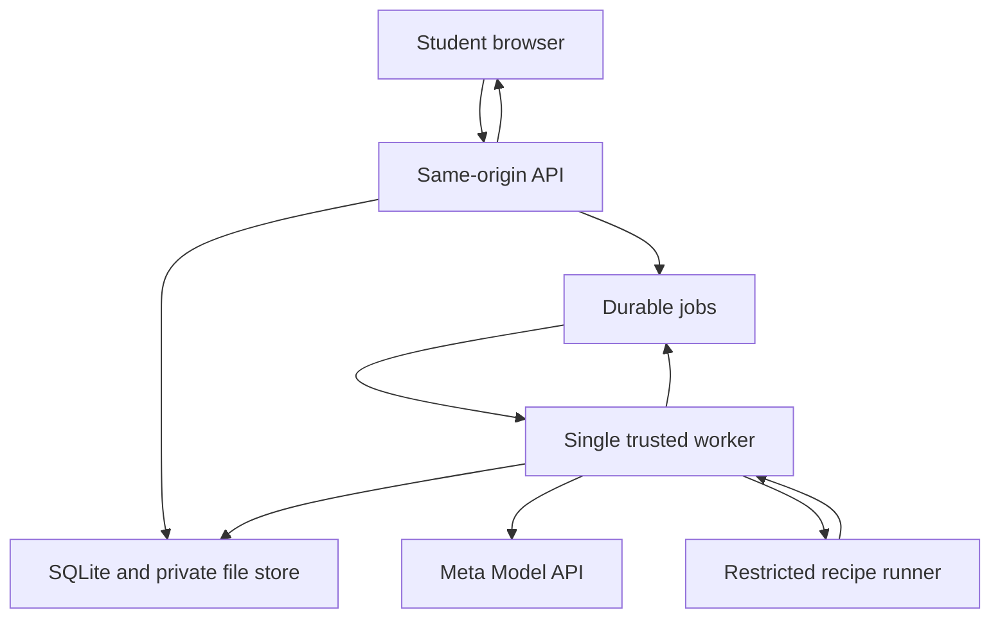
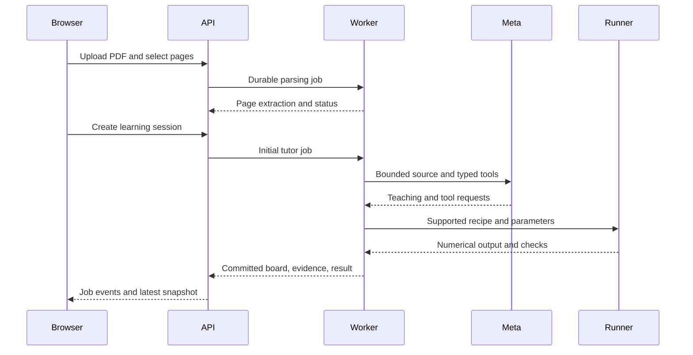

# System Architecture

## Context

ClaimLab has one browser workspace, an authenticated API, a durable worker, a restricted experiment runner, and a Meta provider connection. Documents, board state, run outputs, and learner events belong to a single guest owner.

The job table and application data share SQLite in the first deployment. They are shown separately because they have different responsibilities. The worker owns the narrow ability to start reviewed runner containers; neither model tools nor the browser receive that capability directly.

## Service responsibilities

**API:** Authenticate the guest, validate owner access and revisions, accept uploads/events, reserve idempotent jobs, return snapshots, and stream retained job events.

**Worker:** Claim one durable job, read the needed bounded context, call Meta or the runner, validate results, commit checkpoints, and report truthful terminal state.

**Runner:** Execute only a recipe ID plus strict numeric parameters. It receives no model credentials or raw PDF and cannot fetch packages or external data.

**Browser:** Render committed state, maintain local input drafts, submit semantic student actions, and distinguish current results from stale or pending ones.

## Three job kinds

1. `parse_document`: extract pages in a restricted parsing container; retain status and anchors.
2. `tutor_turn`: build bounded context, execute the tool loop, and commit teaching/board/evidence checkpoints.
3. `run_experiment`: run a validated recipe and persist output/checks.

A tutor tool that runs an experiment invokes the runner service directly inside the active worker job. It **does not enqueue a child job and wait on the same single worker**, which would deadlock. The child run receives its own run record and events but shares the parent job's cancellation/deadline budget.

## Upload-to-teaching sequence

## State and concurrency

One mutation job may own a learning session at a time. Accepting a mutation checks `expected_revision`, atomically acquires the session's active job slot, and records an idempotency key. Worker checkpoints use the active job ID and current fencing generation to prevent stale workers from writing.

Board patches are atomic individually. Cancellation preserves already committed teaching steps but prevents subsequent writes. A final result includes the parameters hash, recipe version, document selection identity, and produced revision. Changes to active inputs label an old result stale.

## Job lifecycle

Jobs move `queued → running → succeeded | failed | cancelled | timed_out`. Cancellation may be requested while queued/running; terminal jobs do not resume. The API writes the cancellation flag; the worker checks between steps and terminates a local runner promptly. Remote model cancellation is best effort; late output is discarded.

Heartbeat every five seconds; a 30-second expired lease marks a running job failed with `WORKER_LOST`. Do not automatically replay model calls or runs after a worker restart. A user can explicitly retry through a new idempotent request with a fresh key. Tool side effects within the old job remain recorded.

Every terminal transition atomically releases the session's active-job slot if it still belongs to that job. Lease expiry or cancellation also advances the fence before allowing another job. An old worker can neither commit output nor clear a newer job's slot.

## Data boundaries

Raw files remain private, accessed only through owner-checked endpoints. Send only relevant extracted passages to the provider. Store snapshots and event records separately from sanitized operational logs. Retention and deletion invalidate jobs before removing dependent records and artifacts.

## Growth path

Multiple replicas, distributed workers, managed authentication, OCR, and additional execution providers are later decisions. PostgreSQL plus a proper queue would replace SQLite claims before scaling horizontally. Preserve the logical contracts when changing infrastructure; do not introduce these services solely for the first demo.
