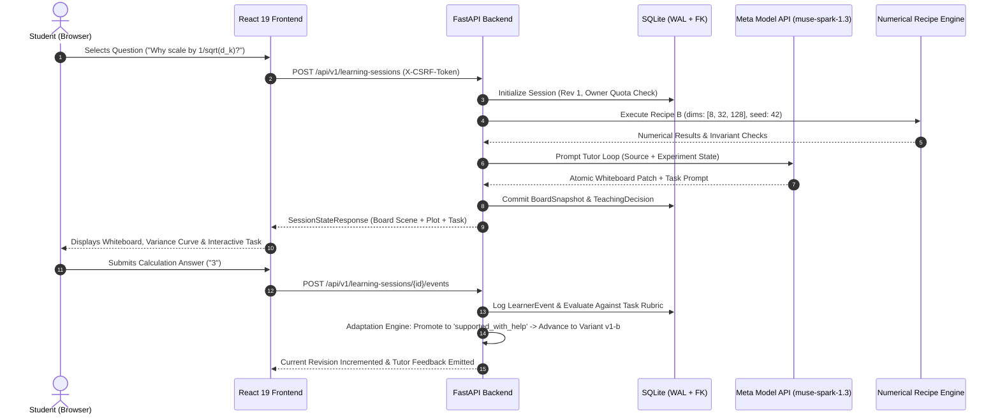

<div align="center">


# ⚡ CLAIMLAB
### Adaptive Whiteboard Teacher &bull; Verified Numerical Labs &bull; Evidence-Based Learning

[](https://meta.com)
[](#meta-model-api-integration)
[](#verification--test-evidence)
[](#frontend-architecture)
[](#backend-engine)
[](LICENSE)

```
╔═══════════════════════════════════════════════════════════════════════════════════╗
║   [●] SOURCE GROUNDING   ───►   [◆] VERIFIED EXPERIMENTS   ───►   [■] ADAPTATION   ║
║   100% Retained Metrics  ───►   Zero Hallucinated Graphs   ───►   2-Variant Rule   ║
╚═══════════════════════════════════════════════════════════════════════════════════╝
```

<p align="center">
  <b>ClaimLab</b> is an adaptive AI teaching workstation that combines an interactive whiteboard tutor, three trusted numerical attention experiment recipes, and a closed-loop pedagogical observation engine grounded in real mathematical proofs.
</p>

[Explore Documentation](docs/01_PRD.md) &bull; [Quickstart](#-quickstart--local-deployment) &bull; [Numerical Recipes](#-the-three-verified-numerical-laboratories) &bull; [Architecture](#-architecture--dataflow) &bull; [Test Evidence](#-verification--test-evidence)

</div>

---

## 🌌 System Overview

ClaimLab solves the fundamental failure of modern AI education: **hallucinated diagrams, ungrounded explanations, and superficial conversational chat**. Instead of generating unverified prose or mock charts, ClaimLab pairs **Meta's `muse-spark-1.3`** model with **exact numerical simulation kernels** and a **graph-based whiteboard engine**.

```
  ┌─────────────────────────────────────────────────────────────────────────────┐
  │                               C L A I M L A B                               │
  ├──────────────────────┬───────────────────────────────┬──────────────────────┤
  │  📄 SOURCE VIEWER    │    🎨 SHARED WHITEBOARD       │   🔬 NUMERICAL LAB   │
  │  • Native PDF Parser │    • SVG Scene Graph          │   • Recipe A: Softmax│
  │  • Grounded Citations│    • Atomic Patch Engine      │   • Recipe B: Scale  │
  │  • Anchor Offsets    │    • Live KaTeX Math          │   • Recipe C: Mask   │
  │  • Out-of-Domain Gate│    • Parameter-Bound Plots    │   • Deterministic PRNG│
  ├──────────────────────┴───────────────────────────────┴──────────────────────┤
  │                  🧠 EVIDENCE-BASED TEACHING LOOP                            │
  │  • 12 Canonical Tasks  • Scaffolding Fallbacks  • 2-Variant Mastery Rule   │
  └─────────────────────────────────────────────────────────────────────────────┘
```

---

## ⚡ The Three Core Pillars

### 1. 🎨 Atomic Whiteboard Teacher
* **Transactional Scene Graph:** Every whiteboard change is an atomic patch (`BoardPatch`) validated against base revision numbers.
* **Safe Mathematical Rendering:** Mathematical formulas rendered via **KaTeX** with strict sanitization against script or LaTeX injection attacks.
* **Cascading Connector Integrity:** Graph edges and arrows dynamically reconnect or cascade-remove when concepts are modified.

### 2. 🔬 Verified Numerical Attention Experiments
* **Zero Hallucinated Outputs:** Every curve, bar, and heatmap cell is rendered from actual float64 NumPy outputs computed inside a restricted numerical runner.
* **Reproducibility Guarantee:** Every run produces a deterministic SHA-256 parameter digest and seed tracking.
* **Stale State Indication:** If a student alters parameters on the whiteboard, charts visibly flag as stale until re-executed.

### 3. 🧠 Pedagogical Observation & Adaptation
* **Actionable Evidence:** Student submissions update a dynamic concept mastery record:
  $$\text{Introduced} \;\longrightarrow\; \text{Needs Check} \;\longrightarrow\; \text{Supported with Help} \;\longrightarrow\; \text{Supported Independently}$$
* **Two-Variant Progression Rule:** A learner *cannot* skip to independent mastery on a single lucky answer; they must confirm comprehension across two distinct mathematical variants.
* **Epistemic Labeling:** All tutor explanations explicitly differentiate between `[Source]`, `[Experiment]`, and `[Background]` knowledge.

---

## 🔬 The Three Verified Numerical Laboratories

ClaimLab provides three mathematically rigorous experiment recipes anchored to transformer attention mechanisms:

```
┌──────────────────────────────────────────────────────────────────────────────────────┐
│ RECIPE A: Softmax Sensitivity (softmax_sensitivity_v1)                              │
│   Evaluates:   p_i = exp(s_i * alpha) / sum(exp(s_j * alpha))                        │
│   Invariants:  sum(p) == 1.0  |  Multiplier > 1 sharpens distribution               │
├──────────────────────────────────────────────────────────────────────────────────────┤
│ RECIPE B: Attention Dimension Scaling (attention_scaling_v1)                        │
│   Evaluates:   S = (Q · K^T) / sqrt(d_k)   where Q, K ~ N(0, I)                      │
│   Invariants:  Var(S_unscaled) proportional to d_k  |  Var(S_scaled) approx 1.0     │
├──────────────────────────────────────────────────────────────────────────────────────┤
│ RECIPE C: Causal Masking Invariance (causal_masking_v1)                              │
│   Evaluates:   M_{ij} = -inf for j > i  |  Row-wise Softmax                          │
│   Invariants:  p_{ij} == 0.0 for future tokens  |  sum_{j<=i}(p_{ij}) == 1.0        │
└──────────────────────────────────────────────────────────────────────────────────────┘
```

---

## 🏗 Architecture & Dataflow



---

## 🔒 Security & Ownership Invariants

* **Multi-Tenant Guest Isolation:** Every document, session, and job is tied to an ephemeral HMAC-SHA256 authenticated guest session. Guests cannot enumerate or access another guest's assets (enforced with strict `404 Not Found` returns).
* **CSRF & Idempotency Protection:** All state-mutating requests (`POST`, `PUT`, `DELETE`) require a validated `X-CSRF-Token` header and support idempotent execution keys (`Idempotency-Key`).
* **Complete Privacy Purge (`DELETE /api/v1/me/data`):** Students can instantly delete all their uploaded PDFs, whiteboard snapshots, and learning records from disk and database with full fencing cancellation.
* **Strict Out-of-Domain Boundary:** Non-transformer/botany documents (e.g. `unsupported_sample.pdf`) are classified as `unsupported` and rejected before tutoring to prevent hallucinations.

---

## 🚀 Quickstart & Local Deployment

### Prerequisites
- **Python 3.12+**
- **Node.js 20+** & **npm 10+**

### 1. Clone & Setup Workspace
```bash
git clone https://github.com/Hellinferno/ClaimLab.git
cd ClaimLab
```

### 2. Backend Setup
```bash
# Create and activate virtual environment
python -m venv .venv
.\.venv\Scripts\Activate.ps1   # Windows PowerShell (or source .venv/bin/activate on Unix)

# Install locked dependencies
pip install -r backend/requirements.txt
pip install -e backend --no-deps

# Run full test suite (18 unit & acceptance tests)
pytest backend/tests/ -v

# Start FastAPI server
python -m uvicorn claimlab.api:app --host 127.0.0.1 --port 8000 --reload
```

### 3. Frontend Setup
```bash
# Install frontend dependencies
npm --prefix frontend install

# Build production bundle
npm --prefix frontend run build

# Start Vite dev server
npm --prefix frontend run dev
```
Open **[http://localhost:5173](http://localhost:5173)** in your browser.

### 4. Background Async Worker (Optional)
```bash
python -m claimlab.worker
```

---

## 🤖 Meta Model API Integration

ClaimLab is built specifically for **Meta's `muse-spark-1.3`** model:

```ini
# .env Configuration
APP_ENV=development
MODEL_MODE=fixture          # Switch to 'live' when META_API_KEY is supplied
META_MODEL=muse-spark-1.3
META_API_URL=https://api.meta.ai/v1/chat/completions
META_API_KEY=your_meta_api_key_here
MAX_TUTOR_TURNS=5
BUDGET_RESERVATION_TOKENS=4096
```

> **Hackathon Invariant:** When `MODEL_MODE=fixture` is active, the UI and API explicitly display `[fixture: muse-spark-1.3]`. Development fixtures produce deterministic tool invocations and whiteboard patches strictly matching the Meta model tool-calling protocol.

---

## 🧪 Verification & Test Evidence

| Test Suite | Spec Reference | Status | Details |
|:---|:---|:---:|:---|
| `test_numerics.py` | T-NUM-01..03 | **PASSED** | Softmax sensitivity, dimension scaling variance, causal mask zero-weights |
| `test_runner.py` | T-RUN-01..02 | **PASSED** | Deterministic SHA-256 parameter hashing and seed verification |
| `test_api.py` | T-JOURNEY-01 | **PASSED** | Full end-to-end learning journey, CSRF token handling, and variant evaluation |
| `test_complete_spec.py::test_t_auth_01` | T-AUTH-01 | **PASSED** | Guest creation, HMAC cookie validation, CSRF verification |
| `test_complete_spec.py::test_t_board_01` | T-BOARD-01 | **PASSED** | Atomic patch engine, max 100 objects, cascading connector deletion |
| `test_complete_spec.py::test_t_tutor_01` | T-TUTOR-01 | **PASSED** | Topic boundary detection rejects out-of-domain botany PDFs |
| `test_complete_spec.py::test_t_learn` | T-LEARN-01 | **PASSED** | Two-variant progression rule before reaching `supported_independently` |
| `test_complete_spec.py::test_t_idem_01` | T-IDEM-01 | **PASSED** | Idempotency replay with matching hash; rejects mismatched fingerprints |
| `test_complete_spec.py::test_t_job_cancel` | T-JOB-01 | **PASSED** | Cooperative job cancellation and fencing generation increments |
| `test_complete_spec.py::test_t_data_01` | T-DATA-01 | **PASSED** | Instant 401 rejection post-deletion and physical file purge |

```bash
======================== 18 passed, 1 warning in 2.29s ========================
```

---

## 📂 Repository File Structure

```
ClaimLab/
├── assets/
│   └── banner.png                     # Cyberpunk Matrix Hero Banner
├── backend/
│   ├── pyproject.toml                 # Build configuration
│   ├── requirements.txt               # Locked dependencies
│   ├── src/claimlab/
│   │   ├── api.py                     # Complete FastAPI REST & SSE endpoints
│   │   ├── config.py                  # Pydantic environment settings
│   │   ├── database.py                # SQLite WAL connection management
│   │   ├── models.py                  # 17 SQLAlchemy entities
│   │   ├── security.py                # Guest session cookies & CSRF HMACs
│   │   ├── worker.py                  # Background durable worker loop
│   │   ├── contracts/                 # Strict Pydantic interface contracts
│   │   ├── numerics/                  # Exact numerical recipe calculations
│   │   ├── whiteboard/                # Atomic whiteboard patch engine
│   │   ├── learning/                  # 12-task canonical bank & adaptation policy
│   │   └── services/                  # PDF parser & Meta agent orchestrator
│   └── tests/                         # Pytest verification suites
├── frontend/
│   ├── package.json                   # React 19 + TypeScript 5
│   ├── vite.config.ts                 # Vite bundle configuration
│   └── src/
│       ├── App.tsx                    # Main reactive workspace layout
│       ├── types.ts                   # Client contract interfaces
│       └── components/                # Whiteboard, Lab, TaskCard, Viewer, Evidence
├── examples/                          # Reference attention and sample PDFs
├── infra/                             # Isolated Docker runner & parser specs
└── docs/                              # Complete 31-file specification pack
```

---

<div align="center">

**ClaimLab &bull; Built for the Meta Global AI Developer Hackathon 2026**  
*Source-grounded Whiteboard Teacher &bull; Real Numerical Labs &bull; Evidence-based Learning*

</div>
